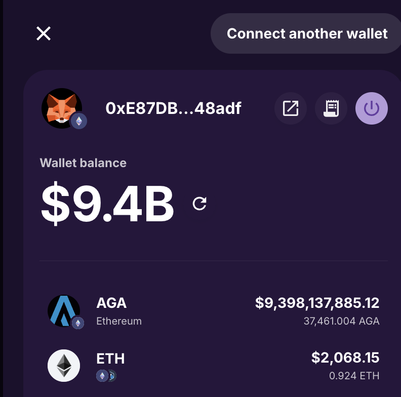

# Task 1 — Understanding the data

## 1. Grain and meaning

**One row** is one `LiFiTransferStarted` event on the source chain: the moment LI.FI's contract, after any source-side swap on the source chain `chain`, passed `minAmount` of `sendingAssetId` to the bridge in `bridge`, in a transaction signed by `tx_from`, to be sent to the `receiver` address on the chain denoted by `destinationChainId`. One row is one bridge leg started. The dataset contains events from Tuesday 2026-10-13 00:00:00 UTC to 2026-10-19 23:59:49 UTC, 168 hours on every chain (query `04_window_hours_and_gaps_by_chain`). Table 1 walks through the seven outer columns and the ten `bridgeData` keys.


**What it is not:**
- not a quote: requests that never executed do not appear;
- not a failed source transaction: the file contains only successful starts;
- not a completed transfer. I sampled 2,000 transfers uniformly, plus 600 equal per chain and 294 edge cases, with the LI.FI [transaction status API](https://docs.li.fi/api-reference/check-the-status-of-a-cross-chain-transfer) (`analysis/notebooks/03_transfer_status.ipynb`): 98.2% of started transfers completed (queries `44_status_completion_rates`, `55_status_edge_case_checks`, reference data);
- not the user's input: a source step ran first in 67.8% of rows, as the `hasSourceSwaps` flag indicates (query `45_file_level_counts_and_flag_shares`);
- not always a bridge: 295 same-chain swaps use the same event (query `65_started_volume`);
- not all of LI.FI: 6 EVM source chains (`base`, `ethereum`, `bnb`, `arbitrum`, `polygon`, `optimism`) of the 65 LI.FI serves, and one event type. `destinationChainId` has 69 distinct values: 64 of LI.FI's 71 listed chains, plus 5 ids the API does not list, Tron's contract-side id and four delisted chains (queries `54_reference_coverage_counts`, `48_usd_by_destination_chain`, `53_rows_by_destination_chain_type`, reference data).

**Keys:** `(chain, tx_hash, log_index)` is unique. `transactionId` is the internal identifier/business key, with 6 ids appearing twice (the same quote executed twice). 11 blockchain transactions carry two events, each its own transfer (query `06_key_uniqueness`).


**Table 1, the fields.** The seven outer columns, then the ten `bridgeData` keys.

| Field | Meaning | Relevant details |
|---|---|---|
| `chain` | source chain name, six values | "by chain" means the source chain unless a breakdown says destination |
| `block_time` | block timestamp, UTC, to the second | taking the hour floor, it can be used as the join key to `prices` |
| `block_number` | block of the event on the source chain | |
| `tx_hash` | the transaction hash on the source chain | 11 on-chain transactions carry two events, each its own transfer (query `06_key_uniqueness`) |
| `log_index` | position of the event in the block | together with `chain` and `tx_hash` the unique key (query `06_key_uniqueness`) |
| `contract_address` | the emitting contract | one value on all six chains, `0x1231deb6f5749ef6ce6943a275a1d3e7486f4eae`, the LI.FI Diamond ([contract addresses](https://docs.li.fi/introduction/lifi-architecture/smart-contract-addresses); query `45_file_level_counts_and_flag_shares`) |
| `tx_from` | the address that signed the transaction | equals `receiver` in 67.8% of rows, but only 13% for `base-app` and `phantom`, whose rows are signed by relayers: 123 addresses that sign for 5 or more integrators sign 11.1% of all rows and almost never receive what they send (queries `45_file_level_counts_and_flag_shares`, `09_integrator_rows_and_senders`, `131_relayer_rule_market`) |
| `transactionId` | LI.FI's internal identifier from the quote, not a tx hash | 6 repeats, seem to be real retries (query `07_repeated_transaction_id_pairs`) |
| `bridge` | tool key | 31 keys, all in LI.FI's tool list (query `54_reference_coverage_counts`, reference data) |
| `integrator` | free string that identifies an integrator connection | a partner can have several connections, for dev or test purposes or for several products: 7 families of variant strings in the data (query `61_integrator_name_families`) |
| `referrer` | address field, who might receive some fee split, useful for acquisition attribution as well | zero in 98.3% (query `01_referrer_summary`) |
| `sendingAssetId` | token contract on the source chain; zero address is the native token | 255 (chain, token) pairs (query `54_reference_coverage_counts`, reference data) |
| `receiver` | destination address | one sentinel for non-EVM destinations, 16,668 rows (query `46_receiver_sentinel_by_destination`) |
| `minAmount` | the amount of `sendingAssetId` handed to the bridge on the source chain, in that token's smallest unit, after any source swap. | equals the API's sending amount on 831 of 831 no-swap rows (query `11_status_min_amount_vs_sending_amount`, reference data) |
| `destinationChainId` | LI.FI chain id; non-EVM ids are LI.FI's own | Tron under two ids (query `48_usd_by_destination_chain`) |
| `hasSourceSwaps` | a source step ran | 61.7% of flagged rows are fee collection only (query `58_status_source_steps`, reference data) |
| `hasDestinationCall` | LI.FI runs a call on the destination | only `across` and `stargateV2` set it (query `03_destination_call_by_bridge`) |

## 2. Pitfalls before "USD volume by integrator / bridge / chain"


- **Token identifiers:** 
  - Always use (chain, address) to identify a token or to join on price data, never symbol. For example, memecoins/scam coins can copy blue-chip tickers. Another example in the current dataset `USDC` appears for two different tokens on three chains, and sometimes the decimals can be different on different chains, for example USDC/USDT have 18 decimals on bnb (query `57_token_symbols_addresses_decimals`).

- **Amounts:**
  - `minAmount` is not what arrives and not a destination-side minimum: it is the source-side amount handed to the bridge, in the source chain's decimals (`docs/research/min-amount-semantics.md`).
  - `minAmount` is an exact integer in the token's smallest unit; 11.9% of rows exceed int64, so shift the decimals with exact integer arithmetic, never through a float (query `47_min_amount_above_int64`).

- **Prices:**
  - Make sure the price feed is complete, and has no duplicates.  For example 381 transactions in the dataset has no corresponding hourly price in the price dataset. I used CoinGecko API to get a fill for those (queries `32_usd_by_price_source`, `65_started_volume`, reference data);
  - Control for erroneous prices, providers can sometimes return 0 as price, resulting in underreporting without any visible error, or sometimes some unreasonably large prices can cause overreporting (see screenshot from jumper app)
  - price discrepancies between feeds cause reporting errors: `GEAR` in the provided feed was at least 1.5× CoinGecko for 23 hours, peaking at 2.6× (query `51_price_feed_hours_beyond_1_5x`, reference data); Alerts on sudden price changes can help identify these issues. 



*Figure 1. A thin token's feed price turning 37,461 AGA into a $9.4B wallet balance in the Jumper app's wallet view, 2026-10-30.*

- **Native assets:** the zero address is the native token (ETH, BNB, POL), 32% of rows; polygon's POL has no price in the provided feed, 364 rows (queries `45_file_level_counts_and_flag_shares`, `33_rows_not_priced_by_provided_feed`).
- **Chains:** `chain` is the source chain, so a "by chain" breakdown must say source or destination. 13.3% of rows go to non-EVM destinations and 21.7% to Robinhood Chain, which never appears as a source, so a source-only view misses a fifth of the traffic; Tron appears under two ids, and the 295 same-chain swaps are not bridge volume (queries `53_rows_by_destination_chain_type`, `48_usd_by_destination_chain`, `65_started_volume`).

- **Concentration:** a few transfers move the week: 22 rows above $1M are 24.7% of USD, one address's 9.52M USDC round trip is 6.2% with both legs counted, and `Pharos-Bridge` drops from rank 5 to 33 without its two rows above $1M. Report counts and medians beside USD, and list the rows above $1M (queries `28_usd_concentration`, `65_started_volume`, `24_integrator_usd_without_rows_above_1m`).
- **Integrator naming:**
  - an `integrator` string is for one connection; a partner can have several connections for testing/dev purposes or for different product lines (7 families of variant strings here, query `61_integrator_name_families`). A breakdown per partner should be done via a dedicated dimension dataset. 
  - the `integrator` string seems to be free form, chosen by the partner, so it should be considered with care.  For grouping, or for labelling, once again it would be best to use internal partner identifiers via a dedicated dimension table.  The partner can choose non-descriptive integrator name, or even mimic another organization. 
  - look-alike pairs such as `dcent` / `dcent_region` and `request-api` / `request-network-api` show how a free string over-counts partners, and five strings the map could not classify with confidence (`lifi-sdk`, `li.fi-solver`, `LIFI-BUMI-PROD-API`, `abs.jmp.exchange`, `adev`) are questions for LI.FI (`data/reference/integrator_map.csv`).
  - test/dev connections are also in there, which might not be relevant for some business breakdowns. 
  - LI.FI's own products are also in the dataset, depending on the request, these might need to be excluded/included.  38.7% of started volume (query `67_started_volume_by_partner`);
  
- **How much the choices matter:** the price feed, the same-chain swaps and the repeated ids each move the week's total by under 0.1%; leaving out the six `_`-prefixed strings (large partners such as `_binancewallet` and `_arbitrum`) moves it by 28.8%, and leaving out the `jumper.*` and `lifi-*` strings by 35.5% (the pattern misses part of LI.FI's own products, which are 38.7% by class) (query `31_started_volume_candidates`). Which integrators count is the choice that matters.

- **Receiver**
  - for non-EVM chains the `receiver` address is always a sentinel, not the real destination. 
  - `destinationChainId`, not all ids appear in the chains dataset from the general API calls. Historic datasets can contain sunset chains. 

- **What the event does not capture:** 
  - it doesn't report completion, potential refunds (1.5%), what arrived, or fees (query `44_status_completion_rates`, reference data).


## 3. Validation of "last week's bridge volume"

Most checks should be automated alerts over curated datasets; 'on the spot' validation is the last line of defence, not the first.

- **Make sure there are agreed/accepted definitions:** 
  - What is a week (Sunday to Saturday?, Monday to Sunday? something else?, the dataset is from Tuesday to Monday), make sure the BI tool has also consistent definitions. 
  - Volume counted on source or destination chain, before or after fees? 
  - Do we consider lifi products? Do we consider dev/test connections? do we consider same-chain swaps. 
  - What currency we use for volume (USD, EUR, other?)

- **Use curated datasets**
  - Don't build the query from scratch or raw feeds. There should be curated gold layer models with most common breakdowns available. 
  - If the query is about a breakdown or a subset of chains or integrators, still start from the curated model and filter it, rather than from raw events.

- **Automated Checks for data availability/accuracy/completeness**:
  - price feed completeness: alerts if unique (chain, token, hour) number dips below threshold, suggesting that some prices are missing. Or if there are transactions which don't have a corresponding price for the hour.   (query `65_started_volume`);
  - price feed integrity issues can be captured by alerts on sudden price changes, or comparison to independent price feed. (query `36_price_feed_total_provided_vs_coingecko`, reference data). 
  - transaction feed completeness: set up alerts that could catch data outages, missing integrator, missing source/destination chain, missing bridge (queries `04_window_hours_and_gaps_by_chain`, `50_hours_far_from_chain_median`, `15_bridge_activity_span`);

- **Reconcile/audit against** (not really day-to-day effort, either automation, or recurring audit )
  - reconciling transaction events against another source, comparing row counts or raw token sums to make sure analytics and backend databases are consistent. For example a daily automation in off-hours. Can alert for mismatch, and report mismatching transactions. 
  - secondary datasets from blockchain explorers/dune analytics to carry out daily/weekly reconciliation checks. 
  - the governed metric in Omni, with an agreed tolerance such as 0.1%. What the checks above return on this sample is in Appendix A.
  
- **Human sanity check**:
  - Check time-series to spot major deviation. Check daily/hourly charts to spot outages/missing data. 
  - Check common breakdowns, do the usual big integrators/chains/etc. show up, or maybe some big group is missing ? 
  

## 4. Limits


- **Success rate.** The event is the start only. Needs status per transfer (the backend's transfer status, `/v1/status`, or the destination-chain completion events). I did some sample of the API endpoint, which showed 98.2% of bridge transactions were actually completed (query `44_status_completion_rates`, reference data).
- **Execution time.** Needs the destination-side timestamp from the status source. In the sample the median is 3 seconds from source block to destination block, p90 38 seconds over 2,557 completed transfers (query `13_status_time_to_completion_by_bridge`, reference data).
- **Quote to transaction conversion rate.** We don't know what percentage of users initiate the tx after seeing the quote. Dedicated quote data can help establish conversion rates.  Quote -> transaction signed -> transaction succeeded. 
- **No data on the source-side swaps.** The event is the bridge leg; the swap before it (the user's input token and amount, the route taken) is not in the file, only the `hasSourceSwaps` flag. Needs the step-level backend records or the status API's included steps.
- **No slippage or execution quality.** No destination amount, no gas, no quote to compare against. Needs status data with both legs' amounts; in the sample what arrives is a median 0.9965 of what was sent, in USD (query `42_status_received_over_sent_and_gas`, reference data).
- **Revenue.** No fee in the event. Needs the FeeCollector's `FeesCollected` events plus the fee configuration per integrator. On the fee estimate from the LI.FI API samples, LI.FI earns about 0.9 bps of bridge volume (query `158_fee_schedule_weekly_by_integrator`, reference data).
- **Total LI.FI volume.** Six source chains of 65 EVM chains, no non-EVM sources, one event type (query `54_reference_coverage_counts`, reference data).
- **Users and retention.** `tx_from` is the signer, and `receiver` is a sentinel for 13% of rows (query `46_receiver_sentinel_by_destination`). A `tx_from` count under-counts relayed partners about three times: `phantom` has 703 signing addresses but 2,236 users when a transfer is counted by its receiver (query `152_partner_users_receiver_default`). Needs a per-integrator user id or a wallet-clustering rule, and history.
- **Partner breakdown.** The `integrator` field is a free-string connection key, not the partner. Needs a partner dimension from the integrator registry; `data/reference/integrator_map.csv` is this submission's stand-in.
- **Regional breakdown.** For BD efforts, regional information could be useful, needs partner region information. 
- **Non-EVM destination numbers.** We only see the sentinel address in the dataset. 
- **Can't tell how quotes/execution compares to competitors.**

 

## 5. Definitions

**Started volume (USD)**, semantic-layer name `started_volume_usd`. The USD value of every `LiFiTransferStarted` event: the amount LI.FI's contract handed to a bridge or exchange on the source chain, priced at the hour the event was emitted.
- Grain: one event, keyed by `(chain, tx_hash, log_index)`.
- Measure: `minAmount / 10^decimals * price_usd`, computed with exact integer arithmetic before the decimal shift. `decimals`: per (chain, token address), from `prices.csv` in this exercise and from LI.FI's token list for the pairs it lacks, otherwise from a token dimension table. `price_usd`: the price feed's value for (chain, token address, `block_time` floored to the hour, UTC); in this exercise `prices.csv`, with CoinGecko filling 377 of the 381 rows it cannot price and `price_source` recording which, otherwise a price feed that is consistent with backend price feed, with potential Coingecko, or other external source as backup. `minAmount` is net of source-side fee collection and swaps, so the volume is after fees.
- Included: every row. Both rows of a `transactionId` that appears twice, since both are deposits.

For financial or accounting purposes a minute-level price feed is worth considering, at a cost in the transformation layer.


```sql
-- Started volume by partner on the provided feed, test and dev connections out.
-- ref_integrator_map is data/reference/integrator_map.csv: one row per integrator
-- string with its partner and class. Top line: _arbitrum $61,593,656.84
-- (query 67_started_volume_by_partner). The view transfers_priced adds the CoinGecko
-- fill for 377 of the 381 rows the feed cannot price (query 65_started_volume).
SELECT m.partner,
       sum(CAST(CAST(t.min_amount AS VARCHAR) || 'e-' || CAST(p.decimals AS VARCHAR) AS DOUBLE)
           * p.price_usd) AS started_usd
FROM transfers t
JOIN ref_integrator_map m ON m.integrator = t.integrator    -- the string is the key, the partner the label
LEFT JOIN prices p
       ON p.chain = t.chain                                 -- (chain, address, hour), never symbol
      AND p.token_address = t.sending_asset_id
      AND p.hour = date_trunc('hour', t.block_time)        -- UTC, floored to the hour
WHERE m.class = 'partner'                                   -- not LI.FI's products, unattributed or test traffic
GROUP BY m.partner
ORDER BY started_usd DESC;
```


This week: $307,969,358.59 over 124,858 rows, 4 of them unpriced (query `65_started_volume`, reference data for the CoinGecko-priced rows). 

- Additional flags: flags on dev/test connections, and LI.FI internal product connections would allow to exclude/include those, depending on the request. 

**Completed volume (USD)** is the second metric: started volume restricted to transfers whose status is `DONE` with substatus `COMPLETED`, valued at the started amount. A refunded transfer drops out; a partial delivery is reported separately. It needs additional transaction status data (98.2% of started transfers in the sample, query `44_status_completion_rates`, reference data).

**Bridge volume (USD)**, semantic-layer name `bridge_volume_usd`. Started volume without the same-chain swaps: the rows whose destination chain equals the source chain. Those are exactly the three exchange tools `lifiIntentsDex`, `m0Dex` and `paxosDex`, which emit the same event. Same-chain swaps are reported on their own line and stay in started volume. This week: $307,741,849.38 (query `65_started_volume`, reference data for the CoinGecko-priced rows).


**Active integrator and active partner**, semantic-layer names `active_integrators` and `active_partners`. An integrator is one connection, the `integrator` string as the data has it; a partner is the organisation that owns one or more integrators, through the partner dimension. I define both on the calendar month, for business reporting and historic comparisons (month to month, or vs same month last year comparisons).

I propose to also introduce a threshold in the definition. An integrator is active in a calendar month if its started volume in that month is at least $100. A partner is active in a calendar month if at least one of its integrator connections is active. LI.FI's own products, unattributed API traffic and test or dev connections are not counted; today that exclusion comes from the hand-maintained map, and partner-set tags would make it exact.

The volume threshold is up to internal agreement. It is there to drop test keys and noise, that can inflate numbers, and cause large month to month fluctuations, without real business value. 
It is a USD floor rather than a transfer count or a unique sender condition: `mbridge-stable`, had $2.85M in 5 transfers, `Banxa-EUIV---Production` had 213 transfers from a single sending address (query `103_active_rule_edge_cases`).

The $100 threshold drops 283 of 563 integrators, carrying 0.003% of the integrators' volume (query `102_active_integrators_and_partners`).  It still keeps `request-network-api` with 163 transfers from 53 senders for $519, whose sender count shows real use (query `103_active_rule_edge_cases`).  Table 2 shows how the active integrator count moves with the threshold. Note that here I applied the monthly threshold on the 7 day volume, so it is mostly for illustration (query `101_active_threshold_sensitivity`):

| Floor over the seven days | Active integrators of 563 | Integrator USD excluded | Rows excluded |
|---|---|---|---|
| any transfer | 563 | 0 | 0 |
| $10 | 426 | 0.0002% | 0.4% |
| **$100** | **280** | **0.003%** | **1.5%** |
| $1,000 | 174 | 0.025% | 3.4% |
| $10,000 | 92 | 0.19% | 7.3% |
| $100,000 | 49 | 1.0% | 15.1% |

Under the rule, this week: 280 of 563 integrators are active, belonging to 279 of 562 partners; (query `102_active_integrators_and_partners`).

I would avoid week-to-week or rolling 7- or 30-day windows, which might be more suitable for operational/tactical purposes, but will be a source of constant mismatch/misunderstandings between financial reports and tactical/operational dashboards. Instead I propose `daily_active_integrators`, the integrators with at least one started transfer in the UTC day, and `avg_daily_active_integrators` over the month. Both are live and comparable across incomplete months. This week: 219 to 271 integrators a day, 250 on average (query `104_daily_active_integrators_and_partners`). A daily volume  floor would not remove the mismatch between average daily active and monthly active integrator numbers: an integrator at $100 in the month may have no single day above $100, and one active on some days may never reach the monthly floor. Either way they differ; I chose the simpler daily rule.


**The partner dimension** behind it, one row per `integrator` string: `integrator` (the string, the key), `partner` (the organisation), `class` (partner, LI.FI product, etc), `is_test` (set by the partner in its project settings), `display_name` (what partner-facing pages show). See  `data/reference/integrator_map.csv` as a mock-up example.

## Appendix A. This week's checks on the sample

The checks of section 3, run on the sample itself. Figures that use the status sample or the CoinGecko snapshot depend on reference data.

| Check | This week | Query |
|---|---|---|
| Window completeness | 168 of 168 hours with rows on every chain; the largest gap between events is 21.7 minutes | `04_window_hours_and_gaps_by_chain` |
| Price feed integrity | 40,754 hourly prices, no duplicate key, no zero or negative price | `105_price_feed_integrity` |
| Price coverage | 381 rows without a provided price; 377 filled from CoinGecko ($33,366); 4 left unpriced | `32_usd_by_price_source` |
| Feed sensitivity | CoinGecko instead of the provided feed on the same token-hours: −0.037% on the total | `36_price_feed_total_provided_vs_coingecko` |
| Price-hour sensitivity | the previous or the next hour's price: +0.004% / −0.008% | `35_price_hour_alignment` |
| Large transfers | 22 rows above $1M, 24.7% of USD, listed by hand | `29_rows_above_1m_usd`, `28_usd_concentration` |
| Completion | 98.2% of a uniform sample of 2,000 completed (97.5–98.7%) | `44_status_completion_rates` |

The queries are in `analysis/queries/` and run with `uv run lifi-query <name>`.
