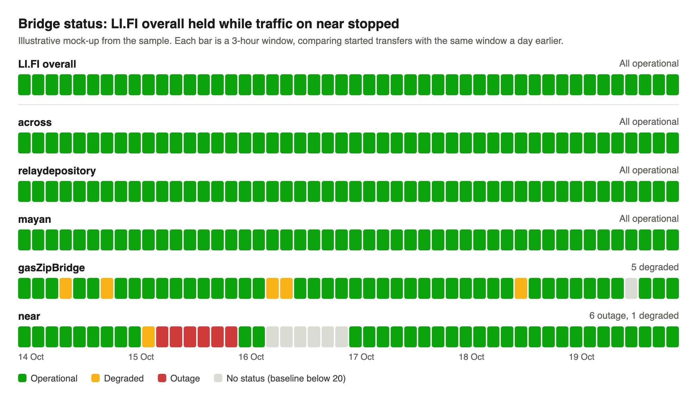
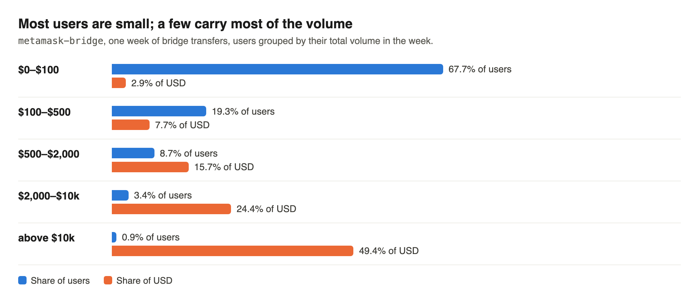
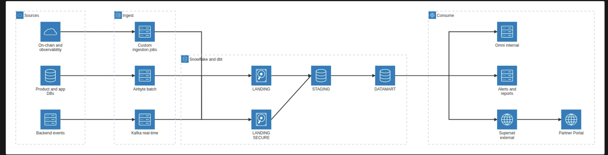

# Task 2 — Partner-facing analytics product

## 1. Who leaves, why, and what data can do about it

The brief mentions two angles: partners evaluating competitors and partners building routing in-house. I will stick to these, and offer potential data solutions/offering that could counteract those drivers. A separate AI research doc is available at `docs/research/task2-market-landscape.md`. 

### 1.1 Value proposition

I see two-three avenues on how an analytics product can improve retention. 
 - Demonstrating the performance or superiority of the underlying product
 - Adding convenience/monitoring features or tools that enables the partners  in their operations
 - Providing additional insights that could enable their business planning better 

Against a partner evaluating competitors, this gives evidence from its own traffic. Against an in-house build, it shows what the partner would have to rebuild and run itself.

#### Demonstrating Superior product (SP)

Data can help demonstrate the performance, or even superiority of LI.FI's offering. Partners signed up for our services because it addressed their business needs. We can demonstrate that we continuously address those needs at high standard, or even better than the competition. 

 - **Best execution price.** Partner is looking for the best execution. 

     - What data can do: Show execution performance (spread/slippage), or even competitive performance, if there is an advantage.
     - Caveats: if there is high competition, it can be tricky to find the right angle, and it can backfire. Still can be very valuable for internal teams. 

 - **Speed.** Quick quote, routing, and execution is relevant for both retail users and institutions who need to act quickly. 

      - What data can do: Show execution speed, competitive performance. Highlight median, p90, p99, execution speed.
      - Caveats: blockchain confirmation speed is given. 

 - **Reliability/availability.** The partner is looking for most reliable platform with the least amount of  downtimes, and fewest execution failures. 

     - What data can do: Demonstrate availability, uptime/health. Issue alerts could be a later product on top of this.
     - Caveats: Can backfire. 

 - **Coverage.** The partner wants full coverage across all chains (EVM, non-EVM) and tokens. 

     - What data can do: Demonstrate coverage, breakdowns, number of available chains, synthetic pairs. 

The above aspects can be the basis for partner facing analytics to demonstrate the product performance. It is also valuable for internal monitoring for us to realize where LI.FI is actually the most competitive, and where we might fall short, allowing focused product development, and focused business development. 

#### "Mission Control" (MC)

Another area  that can improve client retention is providing improved UX for partner business teams. Data can provide additional features that enables partner business teams, either by improved visibility or by providing features that otherwise they would need to build themselves.  

 - **Ease of operations.**  A partner is looking for a complete package, so that they can focus improving other areas of its business, while still having the necessary access and controls to operate this feature. 

     - What data can do: Improved mission control, with more breakdowns, and drilldowns. Customizable reports, export functions.  

 - **Visibility, control, reporting tools.** The increasing regulatory oversights, means companies have to spend more effort on compliance related duties. LI.Fi can offer tools to better enable its partners. 

     - What data can do: Compliance ready reports, like MiCa transaction reporting, sustainability reporting. 

#### Business Insights (BI)

 - **Insights.** Bring actionable insights to the partners using the data only LI.FI has. 

     - What data can do: Providing end user insights, who are using the platform, common routes, demographic segmentation if applicable.  Comparisons on usage/performance with similar partners. 
     - Caveat: might be sensitive on what comparative data we can show, or whether partners take it well that we analyse their activity.

## 2. Improved partner facing analytics product 

Based on the above a couple new thematic additions for the partner portal. 

### 2.1 Execution performance overview (SP,MC)
 
Beyond the existing Volume breakdowns I would add the following elements. 
This would  allow partners to get an overview of the performance of the tool.  
The platform already includes tool-performance monitoring, so building a user facing version should be relatively familiar ground. 

- Execution performance, 
	- net cost distribution average/median/p90/p99 numbers
	- Execution speed, median/p90/p99 speed numbers. 
    - Execution success/fail rate, overall + breakdown per tx size category (categories: $0-$100, $100-$500, $500-$2000, $2000-$10k, etc. )

- Bonus idea: Competitor comparison
	- From on-chain data we could build a comparison on speed, success rate and net cost distribution against competitors. I'm a bit unsure about the details, hidden partner or provider fees might make this comparison skewed/meaningless, plus it can backfire, if competitors decide to introduce discount pricing on certain routes.  

### 2.2 Coverage, reliability (SP, MC)

Similar to a status page, it would allow users to observe the health of the infrastructure, and even serve as a showcase of the service Li.Fi offers, and the value behind using an aggregator vs a single in-house bridge integration. This would be based not on individual partner data, but overall activity within Li.Fi. 

- Per bridge historic health/historic status bars. Based on the number of successful transactions on a given bridge against the same period the previous days/weeks, with 3 categories: operational, degraded performance, or outage. Comparing Li.Fi's overall figure vs the individual bridges, demonstrating that an individual bridge can go down while LI.FI keeps routes working wherever another tool serves them. 

(mock-up from the sample, in the style of Cloudflare's status page; query `155_coverage_status_summary`)

### 2.3 User Insights (BI, MC)

This would bring more breakdowns, and visibility of the partner's usage. Could be more useful for B2B2C partners, probably less so for institutional partners who manage their own assets. 

- Already existing volume breakdown per chain, per top routes. 
- Volume/fee breakdown per transaction size (categories: $0-$100, $100-$500, $500-$2000, $2000-$10k, etc. )
- Monthly active users 
- Monthly active users breakdown per monthly volume category. 
- Month to month user retention/churn rates.
- Monthly active users count breakdown per custom behavioural segmentation (TBD; novice users, bluechip traders, degens).
- User fees breakdown per behavioural segmentation (TBD; novice users, bluechip traders, degens), useful for b2b2c partners. 

(query `154_partner_weekly_users_by_volume_band`)

### 2.4 Fee Planner (BI, MC)

A Tab where users could test various fee setups, based on their historic volume. Of course this wouldn't take into account price sensitivity effects, but would be still a good utility for business planning.

### 2.5 Bonus: Compliance reports export section (MC)

MiCA or other regulatory reporting tools. A big chunk of LI.FI partners might need to adhere to the new regulations. Working with ~1000 integrators (LI.FI's figure) means that LI.FI has a great reach already for kicking off a potential side business. 

- MiCA ready transaction reporting 
- MiCA market abuse reporting 
- MiCA Sustainability reporting. 

 
## 3. Data readiness against the platform diagram

Unless stated otherwise, the data team builds the models and datasets. Product engineering builds the portal pages, the login-based access filter and any backend events not yet on Kafka; it or the platform team would own the CDC stream.

### 3.1 Transaction lifecycle data + execution metrics aggregations. 

Bridge transfers and swaps status (completed, failed, refunded, partial, pending), with fees. Likely already arrives via Kafka from the backend services. I assume overall data models/aggregates on overall metrics also exists, potentially partner specific breakdowns might need to be built by the data team.  

### 3.2 Fee record per transfer + aggregations

Overall fees already exist in the partner portal, so event streams are already in place, adding aggregations for that supports the fee planner would need to be done by the data team.  

### 3.3 Chain, tool  health

At first this could be built based on already existing transaction data, defining bridge health based on comparison against historic LI.FI transaction numbers across all partners. Then the work is once again mostly modelling/aggregations on the data team side. 

As an improved version, we could consider looking at on-chain data for global on-chain traffic for the various bridges, or even bridge specific APIs. This might need involvement from backend teams, depending on whose scope is the  on-chain observability source is. 

### 3.4 End-user breakdown for insights

Work on aggregation/modelling by data team. Potentially for non-EVM bridge txs or gasless  transactions, there is a bit of extra work to extract meaningful user counts. 
### 3.5 Competitor benchmark

This might be a bigger extension for the on-chain observability pipeline, gathering competitor smart contract transactions, and building the full data transformation pipelines which requires understanding the nuances of their transactions. Some knowledge/work might already exist, but this might be a bigger project, considering the large number of competitors. 
**Caveat**: Competing on price is often a race to the bottom. Reminding partners about the price of our service, or even "advertising" competitors can backfire. 

### 3.6 MiCA related partner products

This would need mostly market data. Since I mention it as a potential spin-off, it should be a dedicated team, not the data team or backend. 

### 3.7 Partner-side warehouse delivery

Secure views per partner, with shares or reader accounts, built by the data team on Snowflake, which already exists.

## 4. Metrics

I will pick and define a few metrics across the proposals I mentioned above. 

### 4.1 Bridge volume (USD), `bridge_volume_usd`

- **Definition:** Taken from Task 1. Started volume without same-chain swaps, meaning the USD value of `LiFiTransferStarted` events whose destination chain differs from the source chain, priced at the hour of the event. It does not show whether the transfer completed.
    - Calculation: `minAmount / 10^decimals × hourly price`; with provided price feed, else from CoinGecko. 
- **Source:** The event, prices
- **What the week shows:**
    - $307,741,849.38 over 124,563 rows; same-chain swaps $227,509.22 over 295 rows (query `65_started_volume`).
    - `base-app` $708,467.56, `phantom` $3,081,104.41, `metamask-bridge` $3,060,937.31 (query `154_partner_weekly_users_by_volume_band`; `base-app` has 2 CoinGecko-priced rows, reference data).
### 4.2 Completed volume (USD),completed_volume_usd; Completion rate 

- **Definition:**
    - Started volume restricted to transfers whose status is `DONE` with substatus `COMPLETED`, valued at the started amount; a refunded transfer drops out and a partial delivery (another token) is reported separately.
    - Completion Rate = Completed over started in the period.
    - A transfer inside a bundled transaction takes its status from `batchStatus[].calls[]`
    - A transaction that reverts emits no event, so it is outside this rate; failed attempts come from the status record and are shown as a separate count.
- **Source:** Status per transfer
- **What the week shows:**
    - Uniform sample: 98.2% completed, 1.5% refunded, 0.3% partial (query `44_status_completion_rates`, reference data).
    - Per partner, pooled: `base-app` 96.26%, `phantom` 98.21%, `metamask-bridge` 98.20%, with intervals 4.5 to 7.8 points wide, so none is distinguishable from the market (query `123_partner_completion_rate`, reference data).
    - The longest completion took 48 minutes (query `13_status_time_to_completion_by_bridge`, reference data); the samples were fetched after every transfer had resolved, so the stuck rate is unknown.

### 4.3 Time to completion

- **Definition:**
    - Seconds from the source block timestamp to the destination block timestamp of the receiving transaction; median and p90 by period, tool and route.
    - A negative value from clock differences between chains is floored at 0 and counted.
- **Source:** Status, the sending and receiving timestamps
- **What the week shows:**
    - Median 3 s, p90 38 s over 2,557 completed; by tool, median/p90: `relaydepository` 1/10, `across` 2/10, `mayan` 9/27, `near` 35/112, `polymerStandard` 1,153/1,403; 105 negative values, 75 of them `across` (query `13_status_time_to_completion_by_bridge`, reference data).
    - Per partner, median/p90: `base-app` 6/23, `phantom` 4/29, `metamask-bridge` 2.5/13 (query `124_partner_time_to_completion`, reference data).

### 4.4 Monthly active users

- **Definition:** Distinct users with at least one bridge transfer started in the calendar month. A user is the destination address; for non-EVM destinations, the real receiver from the status record, and the signing address only where that is unavailable (see 4.7).
    - Breakdown by the user's monthly volume band: $0–$100, $100–$500, $500–$2,000, $2,000–$10k, above $10k. 
    - Breakdown by tentative behavioural segment: novice (first transfer in the last 30 days), bluechip (mostly majors and stablecoins), degen (mostly long-tail tokens)
- **Source:** The event, prices; the status record for non-EVM receivers
- **What the week shows:** Monthly users cannot be measured on one week, so weekly users stand in: `base-app` 2,569, `phantom` 2,236, `metamask-bridge` 5,403, on bridge rows only (query `154_partner_weekly_users_by_volume_band`).
    - Most users are small: 81.74%, 67.67% and 67.68% are below $100, while the 0.35%, 1.25% and 0.93% above $10k carry 42.27%, 80.49% and 49.38% of USD.
    - Limit: these sample figures use the signing address on non-EVM rows, so relayers count as users there, which is 15 of `phantom`'s 28 users above $10k and 81.3% of that band's USD.

### 4.5 Monthly retention and churn

- **Definition:** Retained users are active in both the last full month and the month before. Retention = retained users / users active the month before; churn = 1 − retention.
- **Source:** Monthly active users metric

### 4.6 Coverage status per bridge/tool

- **Definition:** Successful transfers in a 3-hour window against the median of the same weekday and 3-hour window over the last 4 weeks.
    - Operational at 50% or more, degraded at 20% to 50%, outage below 20%; no status below 20 transfers in the baseline
    - Source chain, destination chain, tool and LI.FI overall are shown separately
    - The status is labelled as based on traffic, because a fall can also come from routing
- **Source:** transfer data, status per transfer
- **What the week shows:** Tested on started rows against the same window a day earlier, because the sample has one week and no status on every row; the thresholds and window were chosen for this test (query `155_coverage_status_summary`).
    - 14 of 28 tools get a status in 433 of 1,344 windows: 95.6% operational, 2.8% degraded, 1.6% outage. LI.FI overall is operational in all 48 windows.
    - `near` accounts for 6 of the 7 tool outage windows (query `156_coverage_status_not_operational_windows`). On 15 October it fell from 534 to 104 rows while LI.FI's bridge rows reached the week's highest, 19,909 (query `157_near_share_of_bridge_rows_by_day`).

### 4.7 Supporting breakdowns

- **Dimensions:** source chain, destination chain, tool, route, token, transaction size band ($0–$100, $100–$500, $500–$2,000, $2,000–$10k, above $10k), day and hour (UTC), integrator.
- **Users:** A user is the destination address of a transfer. For a non-EVM destination the event shows a placeholder address, 16,668 rows (query `46_receiver_sentinel_by_destination`), so the real receiver comes from the status record, and the signing address is used only where that is unavailable.  Signing addresses alone undercount partners whose transfers are signed by relayers: 123 addresses sign for at least 5 integrators and sign 11.1% of rows (query `131_relayer_rule_market`); `phantom` has 703 signing addresses against 2,236 users, `base-app` 1,043 against 2,584, `metamask-bridge` 5,017 against 5,403, on all rows (query `152_partner_users_receiver_default`). Few destinations are shared: 40 receive from at least 10 signers, 1.54% of rows to EVM destinations, and none from 100 (query `153_receiver_rule_shared_and_bulk_checks`). The sample has no status record on every row, so these figures use the signing address on non-EVM rows, and a relayer signing there counts as a user, which affects 2,046 of `phantom`'s rows (query `152_partner_users_receiver_default`).

- **Net cost to the user (bps):** `(sent USD − received USD − integrator fee USD) / sent USD` on completed transfers, excluding source-chain gas. Rows with a received-to-sent ratio outside 0.5–2 are excluded and counted. On pooled USD totals: `base-app` 169.4, `phantom` 84.4, `metamask-bridge` 48.8, all sampled 8.1 (query `125_partner_net_cost_to_user`, reference data).

## 5. Monetisation

Since the motivation for the new product is to improve partner retention, some elements would be meaningful as free, some partially free, some as premium features. 
Having some features as premium can not only give additional revenue source, but also be used as a signal for interest/impact. 

- The **Execution performance overview**, and **Coverage, reliability** are demonstrating LI.FI system performance/reliability, so we don't want to hide it behind a premium feature. 

- The **User Insights** tab is not meaningful/applicable to all partners. It would make sense to offer it as a free element, with potentially advanced segmentations/breakdowns as premium features. Such features could even include anonymised partner comparisons. These comparisons need care: anonymising does not protect a dominant partner, as `_arbitrum` is 75.6% of partners' USD on Ethereum → Arbitrum (query `127_benchmark_routes`). 

- **Fee planner** could be considered as a premium feature. It should warn that a higher fee can lose quote comparisons at multi-provider wallets. 

- **Competitor benchmark**. It depends, if we can outperform the competitors, this could be even on the public website. 

- **MiCA related partner product**. Premium, or even spin-off offering. These are more than data products. Sustainability report  costs run in the yearly $20,000+, market abuse monitoring $40,000 - $60,000, from my own vendor negotiations in a previous role. Also not applicable to all partners. The value is LI.FI's existing partner network. 

**Additional Monetisation options**:
- partner-side warehouse delivery

**Risks of charging**
- A partner who is hesitant or considering alternatives might react negatively to an additional paywall. The free improvements must deliver a self-sufficient experience, not a freemium demo feel.
- Charging for "basic" things would read as a toll. Paid items should clearly go beyond the partner portal's scope, reflect extra investment on our side, and carry a clear value proposition.
- Income from an analytics subscription would be small against what is at risk, so losing one large partner over a paywall can outweigh it.
- A price raises the bar: a wrong number becomes a dispute, and in a compliance product a liability.

## 6. Trust and governance

How do you guarantee that numbers shown externally are correct, fresh, and consistent with internal numbers in Omni.

Accuracy, consistency with Omni
- Shared lineage: Omni and Superset read the same DATAMART models.
- Metric definitions: the platform treats Omni as the governed source of metric definitions. For partner-facing metrics I would challenge this and move the definitions down into dbt, so that Omni and Superset read one definition rather than two that must be kept aligned. Omni can import metrics defined in dbt's semantic layer, so it stays the internal analysis layer. I would limit this to the metrics partners see, to keep the migration small.
- A daily job compares partner breakdowns in Superset with Omni, because dbt tests cannot see the tools' output.
- data consistency and completeness checks within dbt: dataset completeness, no missing hours, providers, etc. 
- timeouts for transformations, so that a stuck execution doesn't cause issues silently. 
- dbt check that various breakdowns add up to the same overall number.

Accuracy against on-chain/backend: 
 - Regular (daily) consistency checks against a CDC-derived copy of backend data or on-chain sourced datasets. To guarantee that it is not only Omni and Superset that are in agreement, but they both match production/on-chain data. 
 
 Additional comments: 
 - A CDC stream from the backend's database into `LANDING` could serve as an independent verification source so no job reads production tables. 
 - Later option: the same stream feeds  Postgres database projections for semi-real-time data and dedicated serving of the partner facing tools. 
 - Alerting automation in case of processing issues. Slack alerts, with potential on-call rotation. 
- Every page in partner portal could have a  "data as of" from the last successful run or based on the latest transaction on record. 
- Target: hourly refresh. The latest hours are marked provisional while transfers complete, and a failed check keeps the page on its last good data with a visible note.

Access
- Superset shows each partner only its own integrators' rows, through a row-level filter from the portal login. The status page and anonymised comparisons read market-wide aggregates that hold no other partner's rows.
- The public analytics API returns any integrator's transfers without a key, so that gap sits in the API. LI.FI either scopes it by key or documents the data as public.

## 7. Success after 3 months

A/B testing at this scale likely won't  reveal anything + we don't have the luxury of keeping a hold-out group that doesn't receive the updates. I would start with a small closed beta to catch errors, kept out of the impact evaluation, and then a gradual release in multiple stages, which would still allow some impact analysis or difference-in-differences evaluation, allowing to filter out biases from market trends/news. 

Leading signals:

 - **Tool Adoption/Retention**: Share of eligible partners opening the new pages, and the weekly retention rate on the pages.
   
- **Feedback, NPS:** Collecting net promoter score, or detailed surveys, potentially adding "did you find  this useful" buttons on the new pages/visuals.  Monitoring the NPS evolution before/after release. 
 
 - **Support tickets from eligible partners:** The coverage page could provide information for which the partners might have reached out to support beforehand. The decreased support load can be an added benefit .

- **Reach-outs about premium features**: If a partner is interested about a premium feature, it is itself a sign of interest, and that the product hit the right spot. 

- **Internal early-warning:** falling volume, or falling activity on test/dev connections, can show lack of interest in future development with LI.FI's platform. Heavy analytics API usage could signal an in-house evaluation, but only where the caller can be identified, as the API needs no key.

Lagging signals: 

- **Volume change against market/other benchmark:**  Partner volume monitoring on week-to-week or month-to-month volume changes, relative to market volume or  against other partners, or a subset of similar partners. Alerting on low performers/negative outliers. 
  
Possible success metrics after 3 months: 

- At least half of the top 20 partners use the pages weekly. 
- Week to week page retention rate is above 60%. 
- Net promoter score above 30. 
- At least three partner enquiries about premium features. 
- Partners using the pages hold or grow their volume against similar partners who do not (the lagging signal above). After three months, and with partners choosing whether to use the pages, this is a first read rather than proof of retention.

