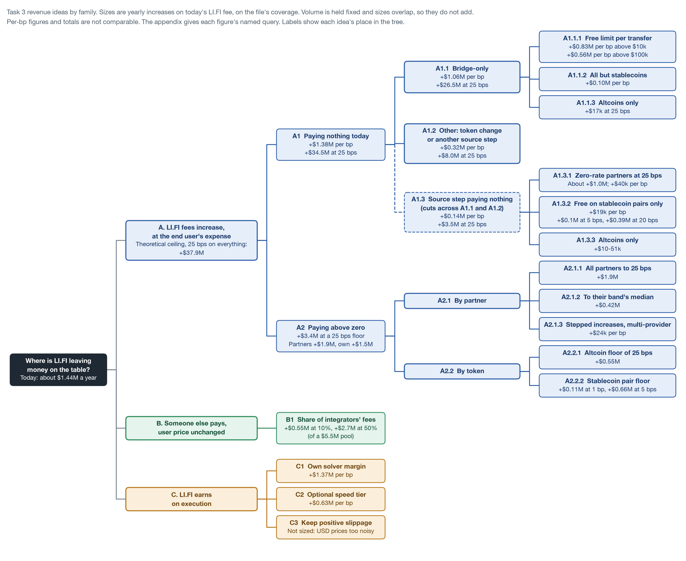

# Task 3 appendix: A structured breakdown for revenue increase ideas. 

> **This appendix is mostly AI-generated, with human review and modifications.** I chose the ideas to keep, the structure and the wording changes; an AI assistant (Claude) drafted the text and the figure and calculated the figures.

Supporting material for `task_3.md`, which keeps four ideas and one must-mention chosen from this structure. 

`task_3.md` § 1, Data used and method, explains how the revenue estimates are calculated, with limitations.  On that basis, LI.FI earns about $1.44M a year today (query `158_fee_schedule_weekly_by_integrator`). Weighting the uniform sample to the file instead gives $1.5M to $2.5M (query `83_revenue_model_weekly_lifi_fee`). Fee totals and per-integrator figures use each integrator's own sampled rate. Figures split by token use every sampled transfer, because token mix varies far more than a partner's rate.

Revenue impact numbers are per year estimates of the increase on today's LI.FI fee, assuming no change in volume. Further studies could possibly come up with a price sensitivity correction  that would influence these estimates.  Some proposals overlap, so the numbers are not additive everywhere. 

Labels such as A1.1.1 show each idea's place in the tree: the family, then each level below it. "Assumed" means the price is an assumption. Statements about competitors and LI.FI's documents come from `docs/research/task3-bridge-only-fees.md`, which gives a source for each.

## A. Ideas where LI.FI fees would be increased at the expense of the end user

### Theoretical ceiling: 25 bps on everything

If we consider every transfer through LI.FI paying  25 bps, the rate its FAQ states and an unconfigured caller pays in live quotes. This gives a theoretical increase of about $37.9M (query `163_ceiling_and_25bps_floor_by_class`), or $39.3M in total (query `84_revenue_sensitivity_to_fee_rate`). It is an upper limit and not a proposal: direct routes for USDC from Ethereum to Arbitrum cost about 1 bp or less. It splits into A1 and A2.

### A1 Paying nothing today

Introducing LI.FI fees on volume that pays LI.FI nothing today, about $270M a week and 87.85% of bridge volume. This is worth $1.38M per bp, or $34.5M at 25 bps (query `161_volume_split_paying_by_route_kind`).

It has two parts: $243.3M a week with no source step (query `84_revenue_sensitivity_to_fee_rate`), and about $27M with a source step that pays LI.FI nothing (query `161_volume_split_paying_by_route_kind`). "Nothing" means nothing in the quote or the transaction. Private terms, such as invoices or bridge rebates, cannot be seen in this data.

#### A1.1 Bridge-only

The same token across chains with no DEX step, where LI.FI is paid nothing: about $208M a week. This is worth $1.06M per bp, or $26.5M at 25 bps (query `161_volume_split_paying_by_route_kind`).

- **Who sits here:** mainly `_arbitrum`, `Pharos-Bridge`, `_binancewallet`, and `jumper.exchange` stablecoin rows, which Jumper's fee page lists at 0 bps (query `150_status_bridge_census_fee_usd_by_integrator`, at $100k and above).
- **Not all bridge-only is free:** a further $18M or so of volume a week already pays LI.FI and sits in A2 (query `161_volume_split_paying_by_route_kind`). Default callers pay 25 bps on a same-token bridge, so this idea means repricing named integrators, not introducing a new fee.
- **Main risk:** direct fast routes cost about 1 bp and slow CCTP routes about 0, so any fee gives large senders a reason to go direct. CCTP is Circle's own protocol for moving USDC between chains; its Standard transfers are free but wait for the source chain to finalise. A direct fast route means a user going straight to a bridge such as Across or Relay, without LI.FI, and getting a quick fill for about 1 bp.

A couple of variations that would limit the risk and the impact. 
##### A1.1.1 Free limit per transfer

Charge only the part of a transfer above a free limit, so small transfers stay free.

- **Size:** $0.83M per bp above a $10k limit and $0.56M per bp above a $100k limit. Charging the whole transfer above $100k gives about $0.70M per bp (query `168_bridge_only_free_limit`). The $10k to $100k band rests on 21 sampled bridge-only rows, and the $0.56M is exact.
- **Who pays:** few senders. Above $100k, 244 senders hold the volume with no source step, and the top 10 hold 51% (query `169_senders_no_source_step_above_100k`).
- **Market:** no aggregator, wallet or bridge checked has a per-transfer free limit. The size rules that exist are minimum fees, which work the other way.
- Main risk: would fall on large senders, who have the cheapest direct alternatives. 

##### A1.1.2 Keep stablecoins free, add fee on other bridge only transfers

Stablecoins stay free and every other token pays. This gives about $0.10M per bp, because stablecoins are about 92% of this volume (query `170_bridge_only_by_token_class`, on the file's sending token). Jumper's published schedule already follows this logic: stablecoin bridges 0 bps, major tokens 2 bps, others 5 bps.

##### A1.1.3 Altcoins only

Only altcoins pay, so stablecoins, and bluechip tokens stay free which gives about $17k at 25 bps (query `170_bridge_only_by_token_class`, on the file's sending token). Almost no bridge-only volume is in altcoins, so this version is too small to matter.

#### A1.2 Other: token change or another source step

The rest of the volume paying LI.FI nothing, about $63M a week: about $40M changes token inside the bridge, such as `lifiIntents` USDC to USDG, and about $23M has a source step other than the fee step alone (query `161_volume_split_paying_by_route_kind`). That step is usually a DEX, but it includes tools such as `custom`, mainly `USDai` to `PYUSD` (query `179_dex_step_paying_nothing_by_tool`). This is worth $0.32M per bp, or $8.0M at 25 bps (query `161_volume_split_paying_by_route_kind`). No separate idea is attached to it.

#### A1.3 Source step paying nothing

This view cuts across the two groups above, so its figures do not add to them. These transfers carry a source step but pay LI.FI nothing: about $27M of volume a week, of which about $4M is bridge-only. On about $8M of it the LI.FI line exists with LI.FI's part at 0, and most of the rest has no LI.FI line at all. This is worth $0.14M per bp, or $3.5M at 25 bps (query `161_volume_split_paying_by_route_kind`). The largest are `USDai`, `rabbykmsv2`, `jumper.exchange` stablecoin rows, `Cow` and `_binancewallet` (queries `158_fee_schedule_weekly_by_integrator`, `172_lifi_rate_by_pair_class_named_integrators`).

The next three ideas apply to the four partners whose fee line pays only the integrator: `rabbykmsv2`, `bitget`, `Zerion` and `kyberswap`.

##### A1.3.1 Zero-rate partners at 25 bps

All four pay LI.FI 25 bps on all their volume, about $1.0M, or about $40k per bp (query `165_zero_rate_partners_scenarios`). `rabbykmsv2` alone is $721,675 (query `91_partner_fee_tier_gaps`). Introducing fees these rates risks losing the partners.

##### A1.3.2 Free on stablecoin pairs only

The four partners stay free on stablecoin-to-stablecoin transfers and pay on the rest. This gives about $19k per bp: $0.1M at 5 bps and $0.39M at 20 bps. `rabbykmsv2` alone is about $59k at 5 bps (query `165_zero_rate_partners_scenarios`). The precedent is `metamask-bridge`, which pays no LI.FI fee on 41 of 43 sampled stablecoin pairs and 5 bps on other pairs (query `172_lifi_rate_by_pair_class_named_integrators`).

##### A1.3.3 Altcoins only

The four partners pay only on altcoins, $10k to $51k at 5 to 25 bps. `rabbykmsv2` is about 3% altcoins, which is about $23k at 25 bps (query `165_zero_rate_partners_scenarios`), so this version keeps the partners but earns little. 

### A2 Paying above zero

Every transfer already paying LI.FI above zero moves to at least 25 bps, and rates above that stay as they are. The volume is about $37M a week, which pays about $1.44M a year today. The increase is about $3.4M: about $1.9M from partners and about $1.5M from LI.FI's own products, mainly Jumper (query `163_ceiling_and_25bps_floor_by_class`). It includes about $18M a week of bridge-only (query `161_volume_split_paying_by_route_kind`). The risk is losing partners on low rates, such as `phantom` at 4.33 bps and `metamask-bridge` and `base-app` at about 5 bps (query `164_partner_integrators_paying_floor_and_band_median`).

#### A2.1 By partner

##### A2.1.1 All partners paying above zero to 25 bps

Every partner paying LI.FI above zero moves to at least 25 bps, excluding LI.FI's own products. This gives an increase of about $1.9M, led by `safe-app` $474k, `mbridge-stable` $356k, `phantom` $325k, `metamask-bridge` $161k and `Reah-PRD` $111k (query `164_partner_integrators_paying_floor_and_band_median`).

##### A2.1.2 To their band's median

The same partners move up to the median rate of partners with similar volume, which gives an increase of about $0.42M. The medians are 4.66 bps at $1M a week and above, 20.25 bps at $100k to $1M, and 25.08 bps below that (query `164_partner_integrators_paying_floor_and_band_median`). For the main partners (query `164_partner_integrators_paying_floor_and_band_median`):

| Partner | Weekly bridge volume band | LI.FI rate today, bps | After, bps | Yearly increase |
|---|---|---|---|---|
| `Reah-PRD` | $100k to $1M | 1.22 | 20.25 | $89,027 |
| `Fireblocks` | $100k to $1M | 2.50 | 20.25 | $64,752 |
| `mbridge-stable` | $1M and above | 0.50 | 4.66 | $60,503 |
| `safe-app` | $1M and above | 3.50 | 4.66 | $36,229 |
| `onekey` | $100k to $1M | 9.95 | 20.25 | $31,381 |
| `sushi` | $100k to $1M | 5.22 | 20.25 | $20,687 |
| `base-app` | $100k to $1M | 5.06 | 20.25 | $19,978 |
| `phantom` | $1M and above | 4.33 | 4.66 | $5,275 |
| `metamask-bridge` | $1M and above | 5.00 | 5.00, no change | $0 |
| `tangem` | $1M and above | 14.12 | 14.12, no change | $0 |
| `_ledger` | $1M and above | 20.27 | 20.27, no change | $0 |

The middle band's median is about four times the top band's, so most of the increase comes from a few partners moving a long way, such as `Reah-PRD` from 1.22 to 20.25 bps. Only 6 integrator strings are in the top band and 23 in the middle one.

##### A2.1.3 Stepped increases at multi-provider wallets

`phantom` and `metamask-bridge` choose a provider per quote (query `140_persona_shares`; the assignment is our judgement, and Phantom states it picks the lowest-priced option by default). Raising LI.FI's rate by 1 bp at a time tests our price directly against competitors. This is worth about $24k a year per bp, on $4.65M a week that pays 4.33 and 5.00 bps today, and about $0.49M at 25 bps (query `164_partner_integrators_paying_floor_and_band_median`). Its main value is measuring how volume responds to a fee, which every other size here holds fixed. The metric would be LI.FI's quote win rate per partner, from LI.FI's quote logs. LI.FI's docs say enterprise pricing is agreed per integration, so a step may need the partner's agreement.

#### A2.2 By token

##### A2.2.1 Altcoin floor of 25 bps

Transfers with a source step and an altcoin on either side pay LI.FI at least 25 bps, and blue-chip rates stay as they are. This gives an increase of about $0.55M on about $7.0M a week of altcoin volume, of which about $0.11M comes from zero-rate volume (query `166_pair_class_fee_today_and_25bps_floor`).

- **Why it could work:** on transfers with a source step, altcoin transfers already lose far more to slippage and other costs, a median 104 bps against 6 bps for blue-chip pairs and 2 bps for stablecoin pairs at $100 to $10k. On those transfers, integrators already charge about 49 bps on altcoins against about 22 bps on other tokens under $10k, while LI.FI takes about 11 bps on altcoins and about 12 bps on stablecoin pairs (query `171_rates_and_loss_by_pair_class_and_size`).
- **Precedent:** `jumper.exchange`, `metamask-bridge` and `tangem` already pay different LI.FI rates by token (query `172_lifi_rate_by_pair_class_named_integrators`).
- **Risk:** about 65% of altcoin volume pays LI.FI under 10 bps (query `166_pair_class_fee_today_and_25bps_floor`), so discounted partners would have to agree, and altcoin quotes get worse in comparisons.
- **Limit:** this has to be a surcharge. Cutting stablecoin pairs to zero for everyone would cost about $0.54M and cancel the gain (query `166_pair_class_fee_today_and_25bps_floor`).
- **Data note:** the file's token column shows the token after the source swap, so it understates altcoin volume. This size uses the from and to tokens in the status data.

##### A2.2.2 Stablecoin pair floor

Stablecoin-to-stablecoin transfers with a source step pay a minimum rate on about $34M a week. The increase is about $0.11M at a 1 bp floor, $0.23M at 2 bps and $0.66M at 5 bps (query `167_stablecoin_pair_floor`). Stablecoin pairs with no source step would first need a fee step. Most of it comes from transfers paying nothing today, so it largely overlaps A1. It would reverse the free stablecoin pricing that Jumper publishes and that `metamask-bridge` rows show.

## B. Someone else pays, user price unchanged

### B1 Share of integrators' fees

LI.FI keeps a share of the fee each integrator sets for itself, and the price to the user does not change. The pool is about $5.5M a year: a 50/50 split gives about $2.7M, and a 10% share gives about $0.55M (query `173_integrator_fee_pool_and_shares`). This would mean a dynamic LI.FI pricing. If an integrator increases its prices, it would increae LI.FI's share as well. 

- **Market:** Squid, Enso and NEAR Intents split integrator fees 50/50 by default.
- **Precedent:** LI.FI already keeps 5% on `phantom` and `base-app` (query `96_status_fee_line_lifi_share_by_kind`).
- **Example:** `rabbykmsv2`'s fees are about $640k a year, so a 5% share is about $32k (query `173_integrator_fee_pool_and_shares`).
- **Risk:** partner income falls, so a low share is more realistic than 50/50.

## C. LI.FI earns on execution

### C1 Own solver margin

Route more volume through LI.FI Intents and earn a margin when LI.FI's own solver fills it. This is worth $1.37M per bp on volume not already there (query `174_execution_volume_bases_per_bp`). LI.FI's current margin is not public, and the approach needs capital and carries inventory risk.

### C2 Optional speed tier

Users pay for a faster fill compared to  slow CCTP routes. `polymerStandard` carries about $124M a week with no source step, which is worth $0.63M per bp (query `174_execution_volume_bases_per_bp`). Polymer's fast route quotes 2 bps. Only users who want speed would pay, so the real figure would be much lower. Users get something in return for this fee.

### C3 Keep positive slippage

LI.FI keeps the amount by which a swap beats its quote. We could not size this: at USD prices, transfers with no swap show a positive gap of about $1.7M a year, larger than the $0.59M on transfers with a source step, so the measure is mostly noise (query `175_positive_slippage_on_swap_rows`). 0x, 1inch, OKX and Velora state that they keep positive slippage or surplus. LI.FI's changelog mentions "positive slippage collection" in October 2025, so part of this may already exist.

## Footnote: alternative pricing ideas, not charged per transfer or on volume

These items are not in the image.

- **F1 Chains pay.** Chains could pay LI.FI through integration fees or by sponsoring traffic coming in. This is not sized, and integration fees would be one-time income. 
- **F2 Platform fee.** Partners could pay a fee or minimum commitment for using LI.FI itself, separate from any analytics subscription: $1.2M at $5k a month from 20 partners (assumed). 
- **F3 Bridge rebates.** Bridges could pay LI.FI rebates or volume pricing. There is no data on this, and unlike the two above it would scale with volume: $1.57M per bp (query `84_revenue_sensitivity_to_fee_rate`).
